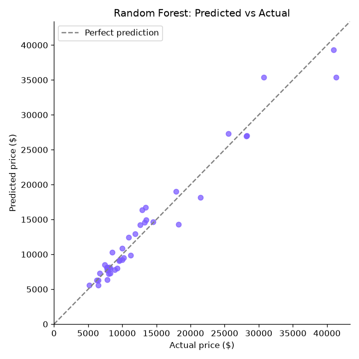
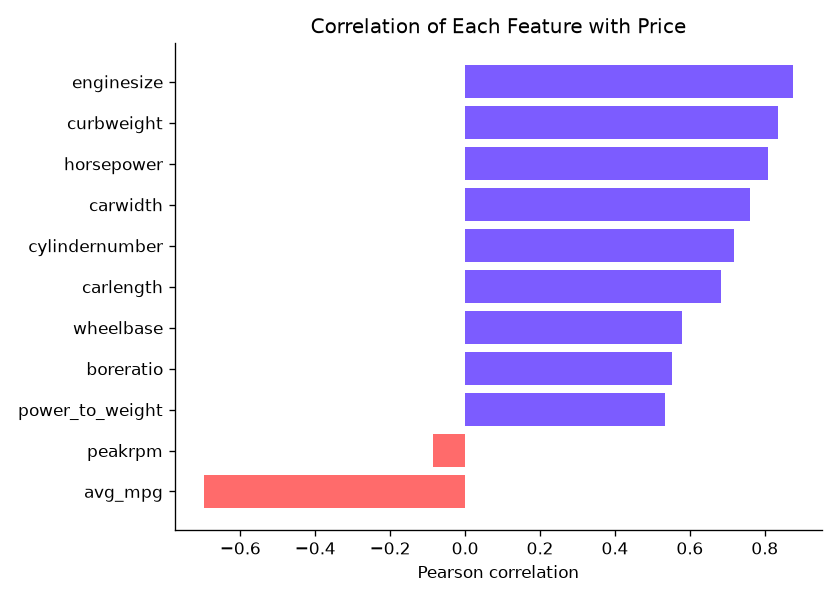
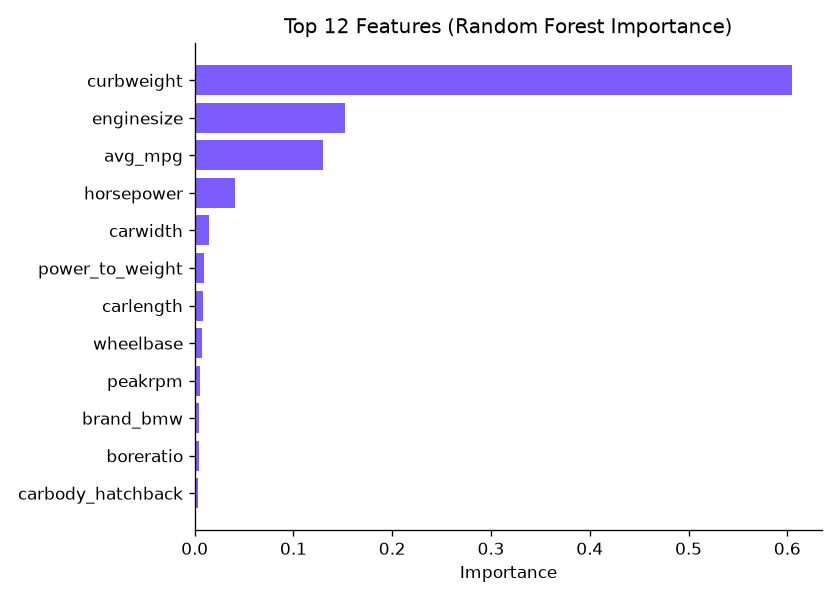
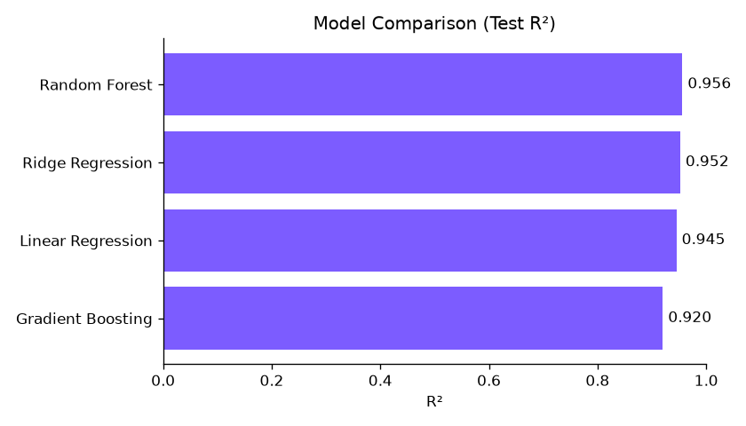
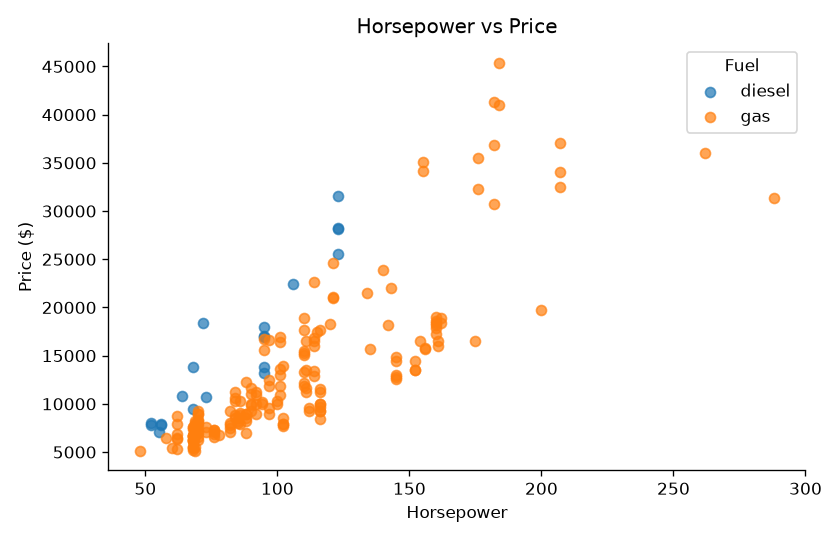

# Car Price Prediction

Predicting car prices from engine specs, size, and brand using **SQL** for analysis and **Python / scikit-learn** for machine learning.



## Results

| Model | Cross-val R² (5-fold) | Test R² | Test MAE | Test RMSE |
|---|---|---|---|---|
| **Random Forest** | **0.885 ± 0.019** | **0.956** | **$1,347** | **$1,869** |
| Ridge Regression | 0.852 ± 0.037 | 0.952 | $1,494 | $1,939 |
| Linear Regression | 0.803 ± 0.045 | 0.945 | $1,556 | $2,081 |
| Gradient Boosting | 0.871 ± 0.039 | 0.920 | $1,778 | $2,516 |

The best model, a Random Forest, predicts price within about **$1,350 on average** on unseen cars, where prices range from $5,118 to $45,400.

Cross-validation R² is the more reliable number here. With only 205 cars, the 41-car test set is small, so one lucky split can make test scores look better than they really are.

## Key Findings

- **Weight and engine size drive price.** Curb weight alone accounts for about 60% of the Random Forest's decisions, followed by engine size and fuel economy.
- **Fuel economy moves the opposite way.** Price has a correlation of about −0.7 with average MPG, because cheap cars tend to be small and efficient.
- **Rear-wheel drive costs more.** RWD sedans average about $21,700, more than twice the $9,800 average for FWD sedans.
- **Turbo diesel is the premium combination.** Turbo diesels average $19,159, while standard diesels average $9,671 and get the best mileage in the dataset (40 MPG).
- **Price tiers follow power.** Premium cars ($20k+) average 163 hp, about twice the 78 hp average of budget cars.

## SQL Analysis

The cleaned data is loaded into SQLite, and five queries in [`sql/analysis.sql`](sql/analysis.sql) explore it using `GROUP BY`, `HAVING`, `CASE` bucketing, and a subquery `JOIN`.

| Brand | Cars | Avg Price | Avg HP |
|---|---|---|---|
| Jaguar | 3 | $34,600 | 205 |
| Buick | 8 | $33,647 | 146 |
| Porsche | 5 | $31,401 | 210 |
| BMW | 8 | $26,119 | 139 |
| ... | | | |
| Chevrolet | 3 | $6,007 | 63 |

Full query outputs are saved in [`results/`](results/).

## Charts

| | |
|---|---|
|  |  |
|  |  |

## Approach

1. **Cleaning** (`src/clean.py`): I fixed misspelled brand names in the raw data (`maxda` → mazda, `porcshce` → porsche, `toyouta` → toyota, `vw`/`vokswagen` → volkswagen). I converted word counts like "four" cylinders to numbers. I also engineered two features: **average MPG** and **power-to-weight ratio**.
2. **SQL exploration** (`src/sql_analysis.py`): Loads the data into SQLite and runs the analysis queries.
3. **Modeling** (`src/train.py`):
   - A scikit-learn `Pipeline` scales numeric features and one-hot encodes categories (brand, body, drive, fuel, engine type).
   - The model trains on a **log-transformed price**, since prices are right-skewed, and converts predictions back to dollars.
   - Four models are compared with an 80/20 split and 5-fold cross-validation.

## Run It

```bash
git clone https://github.com/Andrew-742001/car-price-prediction.git
cd car-price-prediction
pip install -r requirements.txt
python src/clean.py
python src/sql_analysis.py
python src/train.py
```

## Project Structure

```
car-price-prediction/
├── data/          raw and cleaned CSVs
├── sql/           SQL analysis queries
├── src/           cleaning, SQL runner, model training
├── images/        generated charts
└── results/       model scores and SQL outputs
```

## Limitations and Next Steps

- **Old data.** The dataset covers 205 cars with 1980s-era specs and prices, so it teaches the method but won't price a car today. A natural next step is to retrain on a modern used-car dataset that includes mileage and year.
- **Small sample.** Hyperparameter tuning with `GridSearchCV` could help, but with this little data the gains would be modest and easy to overfit.
- **Interpretability.** Adding SHAP values would explain individual predictions.

## Data

The [Car Price dataset](https://raw.githubusercontent.com/amankharwal/Website-data/master/CarPrice.csv) contains 205 cars with 25 features. It is derived from the UCI Automobile dataset.

---

**Htet Aung Shinn** · [GitHub](https://github.com/Andrew-742001)
